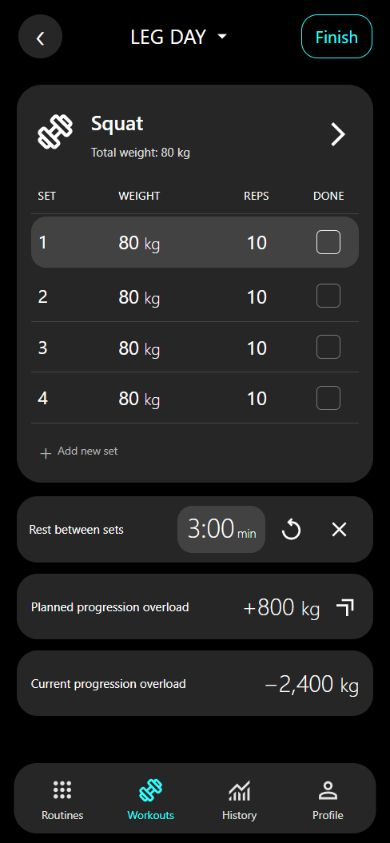
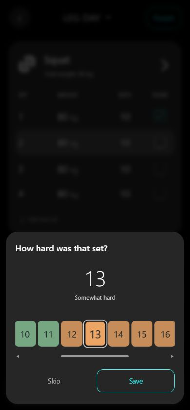

# Final design screen gallery

Primary working-app screenshots use 390 × 844; the offline evidence is a desktop capture. All use synthetic signed-out localhost data. The supplied PDF/icons guide the black background, filled grey panels, cyan controls and one-exercise layout. No phone frame/status bar is drawn. Native layout checks also cover 320, 375, 430 and 1280 px.

| Screen | Screenshot |
|---|---|
| Routines | [Routine list](final-previews/01-routines.jpg) |
| Active | [One exercise and three panels](final-previews/02-active.jpg) |
| Borg RPE | [Rating 13 selected](final-previews/03-rpe.jpg) |
| Rest | [Completed set and next selection](final-previews/04-rest.jpg) |
| Planning | [Previous result and deliberate plan actions](final-previews/05-planning.jpg) |
| History | [Planned versus completed chart](final-previews/06-history.jpg) |
| Selected point | [Sets, Borg and exercise time](final-previews/07-history-detail.jpg) |
| Profile | [Preferences, sync and backup](final-previews/08-profile.jpg) |
| Offline | [Persisted result with server stopped](final-previews/09-offline.jpg) |

Run `node scripts/serve.mjs --port 4173`, open `http://127.0.0.1:4173/tests/preview.html`, choose a screen and **Open isolated preview**. Each launch has its own database; fixtures never upload and are excluded from production.

These show the implementation branch, not a completed hosted release. Earlier images under `previews/` belong to the superseded design.
