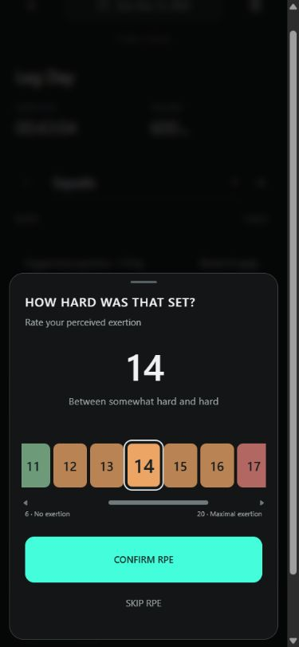
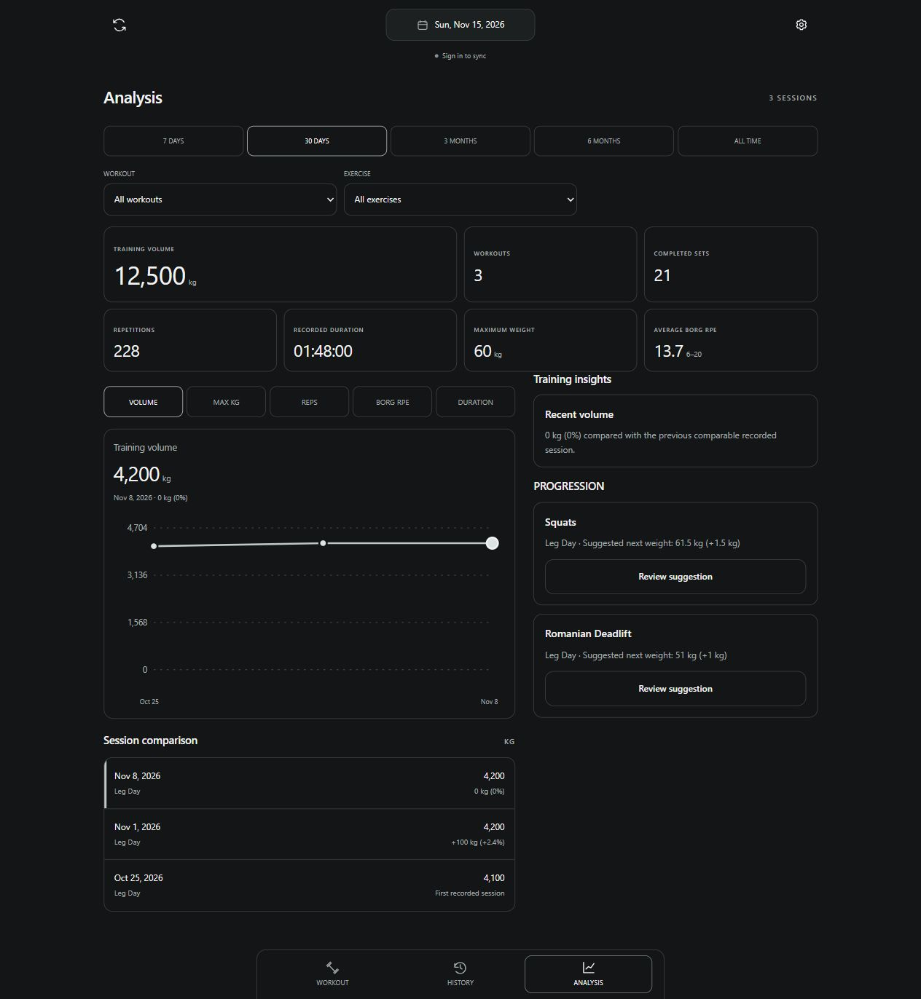

# G-Track 2.0 screen gallery

Actual browser screenshots from the working application using synthetic, signed-out, isolated localhost data. No production workout data appears here. Mobile review used a 390 px viewport; the native test matrix also covers 320, 375 and 430 px. Full-page captures include content below the fold. The desktop analysis capture uses 1280 px.

| Screen | Screenshot |
|---|---|
| 1. Set up your gym day | [Home](previews/01-home.jpg) |
| 2. Workout configuration | [Configuration](previews/02-configure.jpg) |
| 3. Start workout | [Start](previews/03-start.jpg) |
| 4. Active workout | [Active rows](previews/04-active.jpg) |
| 5. Borg RPE bottom sheet | [Borg 6–20](previews/05-borg.jpg) |
| 6. Rest countdown | [Rest](previews/06-rest.jpg) |
| 7. Session summary | [Summary](previews/07-summary.jpg) |
| 8. Analysis dashboard | [Mobile](previews/08-analysis-mobile.jpg) · [Desktop](previews/08-analysis.jpg) |
| 9. Interactive point details | [Recorded sets and history link](previews/09-point-detail.jpg) |

To explore the controls, run `node scripts/serve.mjs --port 4173` from the branch and open `http://127.0.0.1:4173/tests/preview.html`. Select a screen and click Open isolated preview. Home → Leg Day opens configuration; Save Workout opens Start. Each generated preview has its own local database, so an active screenshot session never prevents a fresh home preview.
